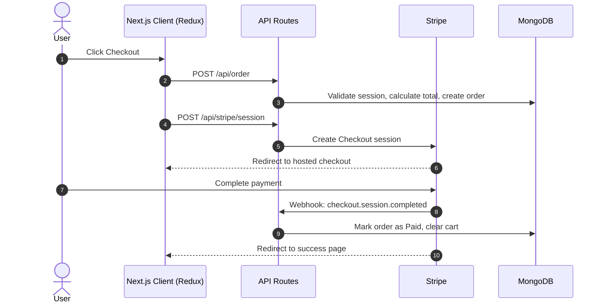
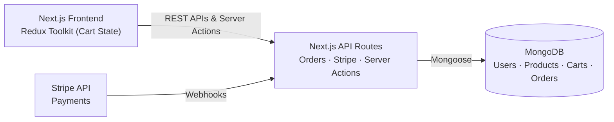

<div align="left">

# Harlow

### Production-grade furniture commerce, engineered for correctness.

A full-stack e-commerce platform built with **Next.js**, **MongoDB**, and **Stripe**. Harlow is engineering-first: the focus is on predictable cart state, webhook-verified payments, and a reliable order lifecycle.


[**Live Demo**](https://harlow.alaminhere.com/) · [**GitHub Repository**](https://github.com/alaminhere/harlow) · [**Portfolio**](https://alaminhere.com/)


</div>

**Redux Toolkit** &nbsp;·&nbsp; **Stripe Webhooks** &nbsp;·&nbsp; **Server-side Validation** &nbsp;·&nbsp; **Secure Order Flow**


--- 

## Architectural Focus

Many e-commerce projects lead with UI. **Harlow** leads with the engineering underneath it, written in pure **JavaScript**:

| Area | What it covers |
|---|---|
| **State Management** | Cart operations (add, remove, increment, decrement) handled with Redux Toolkit |
| **Secure Payments** | End-to-end Stripe Checkout integration |
| **Order Lifecycle** | User orders, statuses, and database writes through dedicated API routes |

> The UI is intentionally kept clean and focused on these flows. For a showcase of advanced UI and dashboard architecture, see my other project, [StoreFlow](https://github.com/alaminhere/StoreFlow).

---

## Core Logic Walkthrough

The most important logic lives in the state layer, API routes, and server actions.

### 1. Redux Cart Management

| | |
|---|---|
| **Location** | `src/redux/features/cartSlice.js` · `src/hooks/useCart.js` |
| **Challenge** | Keeping client UI state in sync with the database without race conditions or desyncs. |
| **Solution** | Custom `createAsyncThunk` factories handle Add, Increment, Decrement, and Remove. The `useCart` hook abstracts dispatch logic so the UI updates only after a successful server response. |

### 2. Order Management API

| | |
|---|---|
| **Location** | `src/app/api/order/route.js` |
| **Challenge** | A reliable pipeline for processing user orders securely. |
| **Solution** | A dedicated REST route validates the user session, calculates totals, and stores order details in MongoDB to keep data consistent. |

### 3. Stripe Checkout & Webhooks

| | |
|---|---|
| **Location** | `src/app/api/stripe/session/route.js` · `src/app/api/stripe/webhook/route.js` |
| **Challenge** | Processing payments securely and marking orders "Paid" only when Stripe confirms the transaction. |
| **Solution** | `session/route.js` creates the Stripe Checkout session. `webhook/route.js` listens for events such as `checkout.session.completed`, updates the order status, and clears the user's cart. |

### 4. Server-Side Cart Validation

| | |
|---|---|
| **Location** | `src/actions/cartAction.js` |
| **Challenge** | Preventing out-of-stock additions and quantity manipulation from the client. |
| **Solution** | Server Actions check real stock in MongoDB before mutating the cart. Helper functions (`isSame`) compare MongoDB `ObjectId`s with frontend `String` IDs safely. |

---

## Checkout Flow



---

## Key Decisions

**Why both Server Actions and REST API routes?**
Server Actions suit cart mutations that are tightly coupled to the UI and benefit from direct server-side validation. REST routes suit orders and Stripe, where external systems (Stripe webhooks) need a stable, public HTTP endpoint.

**Why mark orders "Paid" from a webhook instead of the success redirect?**
A redirect depends on the user's browser reaching the success page. They can close the tab, lose connection, or visit the URL manually. The webhook is sent server-to-server by Stripe, so it is the reliable source of truth for payment status.

**Why validate stock on the server?**
Client state can be tampered with. Server Actions re-check real stock in MongoDB before every cart change, so the UI is never the authority on quantities.

**Why update the UI only after the server responds?**
It avoids desyncs between the Redux store and the database. The trade-off is a small delay on each action, in exchange for a cart that always reflects the real state.

---

## Features

### State & Cart
- **Redux integration:** global cart state accessible from any component
- **Responsive cart UI:** counters and totals reflect the synced state
- **Server-side validation:** stock limits and quantity boundaries enforced by Server Actions

### Payments & Orders
- **Stripe Checkout:** secure, industry-standard payment gateway
- **Webhook handling:** automated order fulfillment after successful payment
- **Order history:** users can view past orders from their profile

### Authentication & Security
- **NextAuth:** user authentication and session management
- **Protected routes:** checkout and order history require sign-in
- **Password hashing:** credentials hashed with Bcrypt

---

## Tech Stack

| Frontend | Backend, API & Services |
|---|---|
| Next.js 16 (App Router) | Next.js API Routes (REST) |
| React 19 | Next.js Server Actions |
| JavaScript (ES6+) | MongoDB & Mongoose |
| Redux Toolkit (`react-redux`) | NextAuth (Authentication) |
| Tailwind CSS 4 | Stripe (Payments & Webhooks) |
| shadcn/ui | Cloudinary (Image Hosting) |
| Lucide React (Icons) | Bcrypt (Password Hashing) |

---

## Architecture



---

## Getting Started

### Prerequisites
- Node.js 20 or newer
- A MongoDB database (local or Atlas)
- A Stripe account (API keys and webhooks)
- A Cloudinary account

### 1. Clone the repository

```bash
git clone https://github.com/alaminhere/harlow.git
cd harlow
```

### 2. Install dependencies

```bash
npm install
```

### 3. Configure environment variables

Create a `.env.local` file in the project root (see the [table below](#environment-variables)).

### 4. Run the development server

```bash
npm run dev
```

Open [http://localhost:3000](http://localhost:3000) in your browser.

### 5. (Optional) Test Stripe webhooks locally

Use the [Stripe CLI](https://docs.stripe.com/stripe-cli) to forward events to your local server:

```bash
stripe listen --forward-to localhost:3000/api/stripe/webhook
```

Copy the signing secret it prints into `STRIPE_WEBHOOK_SECRET`.

---

## Environment Variables

| Variable | Required | Where to get it |
|---|:---:|---|
| `MONGO_URI` | Yes | MongoDB Atlas → Connect, or your local instance |
| `NEXTAUTH_SECRET` | Yes | Generate with `openssl rand -base64 32` |
| `NEXTAUTH_URL` | Yes | `http://localhost:3000` in development |
| `GOOGLE_CLIENT_ID` | Yes | Google Cloud Console → Credentials |
| `GOOGLE_CLIENT_SECRET` | Yes | Google Cloud Console → Credentials |
| `EMAIL_USER` | Yes | Your sender email account |
| `EMAIL_PASS` | Yes | App password for that email account |
| `CLOUDINARY_PRESET_NAME` | Yes | Cloudinary Console → Upload presets |
| `CLOUDINARY_CLOUD_NAME` | Yes | Cloudinary Console → Dashboard |
| `CLOUDINARY_API_KEY` | Yes | Cloudinary Console → API Keys |
| `CLOUDINARY_API_SECRET` | Yes | Cloudinary Console → API Keys |
| `STRIPE_SECRET_KEY` | Yes | Stripe Dashboard → Developers → API keys |
| `STRIPE_WEBHOOK_SECRET` | Yes | Stripe Dashboard → Webhooks, or Stripe CLI |
| `NEXT_PUBLIC_STRIPE_PUBLISHABLE_KEY` | Yes | Stripe Dashboard → Developers → API keys |

```env
MONGO_URI=

NEXTAUTH_SECRET=
NEXTAUTH_URL=http://localhost:3000

GOOGLE_CLIENT_ID=
GOOGLE_CLIENT_SECRET=

EMAIL_USER=
EMAIL_PASS=

CLOUDINARY_PRESET_NAME=
CLOUDINARY_CLOUD_NAME=
CLOUDINARY_API_KEY=
CLOUDINARY_API_SECRET=

STRIPE_SECRET_KEY=
STRIPE_WEBHOOK_SECRET=
NEXT_PUBLIC_STRIPE_PUBLISHABLE_KEY=
```

---

## Roadmap

- [ ] Automated tests (unit tests for cart logic, integration tests for the order and webhook routes)
- [ ] Inventory reservation during checkout
- [ ] Refund handling via Stripe webhooks
- [ ] Order status emails

---

## Author

**Md. Al-Amin**, Full-Stack Developer

[Portfolio](https://alaminhere.com/) · [LinkedIn](https://www.linkedin.com/in/alamin-here) · [GitHub](https://github.com/alaminhere)

---

## License

This project is licensed under the **MIT License**.